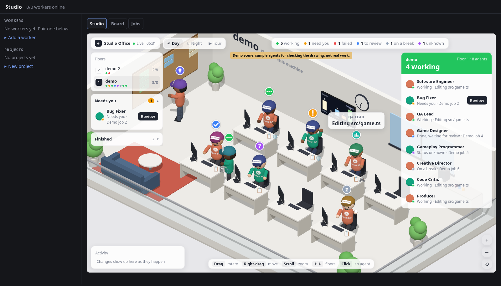

# Studio

**A harness of harnesses, shown as a game dev studio.**

Studio runs real coding agents (Claude Code, Codex, OpenCode) on real projects across every
computer in the house, and shows the work as a small office: one floor per machine, a little
person at a desk for each agent, wearing a cap that says what job it was hired for. The game is
how you see the work, and the work is real.



<sub>The 3D office, drawn from a sample scene. In use it only ever shows the hub's real state.</sub>

```sh
git clone https://github.com/michaelbrave/studio.git && cd studio
./install.sh          # Windows: powershell -ExecutionPolicy Bypass -File .\install.ps1
studio
```

---

## Why this exists

Coding agents are good enough now that the hard part is no longer one agent writing code. It's
running several of them at once, on more than one machine, without babysitting each one:

- **Each harness lives in its own window.** Claude Code, Codex and OpenCode have their own
  sessions, approvals and quirks. Checking on them means flipping between terminals.
- **An agent starts every job from zero.** It doesn't know what the last agent learned, what you
  disliked last time, or which setup does this kind of task well.
- **The machines sit idle.** The desktop in the other room has a GPU and a subscription with
  quota left, and nothing sends it work.
- **Nobody checks the work.** Without a second opinion, "done" means "the agent said so".

[T3 Code](https://github.com/pingdotgg/t3code) already solves the lowest layer well: one server per
machine that drives all the agent CLIs behind a single interface, with worktrees, checkpoints,
approvals and usage-limit recovery. What it doesn't have is the idea of agents as **staff**: a
job description, a set of tools, a shared memory, a reviewer, and one place to see who is doing
what across every machine. Studio is that layer.

The office view is there because a picture of a room is the fastest way to read the state of ten
agents: who's working, who's waiting for you, who failed, which machine went offline. It never
makes anything up. There are no fake progress bars, only states the hub has actually seen.

## What it does

- **One hub, many machines.** Pair each machine's T3 with one code. Jobs go to whichever worker
  you pick, and the hub recovers from dropped connections without running work twice or losing
  the result.
- **Roles and Kits.** Every agent is hired into a **Role** (who it is: personality, duties,
  model; shown as its cap) and equips **Kits** (what it carries: skills, rules, MCP servers,
  permissions; shown as tools on its desk). Studio writes them into the job's worktree in each
  CLI's own format, so the same Role works on Claude Code, Codex or OpenCode.
- **Cross-checks.** When a job finishes, a Code Critic reviews it, on a different harness when one is
  available. It checks the exact commit in its own worktree and runs the tests.
- **Task board.** A Producer agent reads the project and proposes cards with acceptance criteria.
  You approve them, start them, and they move through Doing → Review → Done.
- **Accept and integrate.** Accepted work is merged into the project by an Integrator job, which
  checks that the merged commit is the one that was reviewed and runs the tests on the result.
- **Approvals from Studio.** When an agent asks permission, it raises its hand in the office and
  you answer from the job panel. The Guardrails Kit lets routine commands through (git, tests,
  reads), so most jobs never stop to ask.
- **Ratings, not XP.** Rate finished jobs 1–5 stars. Averages build up per model, harness, Role and
  Kit, and your notes go into the next agent's briefing.
- **A shared memory you can read.** The vault is a git repository of markdown: job records,
  project notes, board cards, feedback. Open it in Obsidian.
- **Discord (optional).** Notifications, a morning brief and approvals through
  [Hermes](docs/discord.md).

## How it fits together

```
          you ── browser ──▶  Studio hub  (this repo, :4600)
                              │  jobs, board, Roles/Kits, reviews, ratings, vault
                              │
              ┌───────────────┼──────────────────┐   T3's MCP + RPC (paired once)
              ▼               ▼                  ▼
          T3 Code         T3 Code            T3 Code        one per machine, stock and unmodified
          this PC         desktop            laptop
              │               │                  │
       claude · codex · opencode  (the agent CLIs, signed in with your own accounts)
```

Studio **sits on top of stock T3 and doesn't fork it.** Gaps found in T3 are worked around in
Studio and offered upstream (see [UPSTREAM.md](UPSTREAM.md)). Studio is tested against the
T3 version in [`T3_VERSION`](T3_VERSION), and the installer installs exactly that one.

## Install

**Needs:** Linux, Apple-silicon macOS or Windows 10/11, `git`, and at least one agent CLI you've
signed in to: [Claude Code](https://claude.com/product/claude-code) (`claude auth login`),
[Codex](https://developers.openai.com/codex/cli) (`codex login`) or
[OpenCode](https://opencode.ai) (its free models need no login).

```sh
git clone https://github.com/michaelbrave/studio.git
cd studio
./install.sh          # or: make install
```

On **Windows**, in a normal (not administrator) PowerShell:

```powershell
git clone https://github.com/michaelbrave/studio.git
cd studio
powershell -ExecutionPolicy Bypass -File .\install.ps1
```

The installer asks before each download, skips whatever is already done, and is safe to run again:

1. **Node ≥ 22.18.** It uses yours if it's new enough. Otherwise it downloads the official build
   into `~/.local/share/studio/node` (Windows: `%LOCALAPPDATA%\studio\node`) and checks its
   checksum. Only Studio uses it.
2. **T3 Code**, at the tested version, with T3's own installer (into `~/.t3`).
3. **Studio's packages** (`npm ci`). There is no build step: Node runs the TypeScript directly.
4. **The `studio` command** in `~/.local/bin`. On Windows it also adds that folder to your user
   PATH, so open a new terminal afterwards.
5. **A check for agent CLIs.** It doesn't install them, because they need your accounts.

Flags: `--yes` (don't ask), `--service` (also start at boot), `--uninstall`. On Windows they're
`-Yes`, `-Service` and `-Uninstall`.

## Use

```sh
studio
```

That's it. It starts T3 if it isn't already running, pairs the hub with it the first time
(no code to copy), starts the hub and opens **http://127.0.0.1:4600**. Ctrl+C stops what it
started. If Studio is already running, `studio` just opens the browser. It works the same on
Linux, macOS and Windows.

| Command | |
|---|---|
| `studio` | start T3 + the hub and open Studio (`--no-browser` to skip the browser) |
| `studio stop` | stop a Studio that `studio` started (in another terminal, or in the background) |
| `studio lan` | the link for opening Studio from another computer; `lan on` / `lan off` / `lan new-key` |
| `studio join <link>` | make this computer support for a main Studio; `studio leave` undoes it |
| `studio service on` | start Studio at boot (Linux, systemd) or at login (Windows, a scheduled task); `off` undoes it |
| `studio service status` | also `start`, `stop`, `restart`, `logs` |
| `studio pair <name> <address> <code>` | add a T3-only machine as a worker (or use **Add a worker** in the UI) |
| `studio doctor` | check Node, T3, agent CLIs, ports and paired workers |
| `studio update` | `git pull`, reinstall packages, restart services |
| `studio open` | open the UI |
| `studio test` | tests + type check |

### More than one computer

Studio runs one hub. It holds the jobs, the vault and the worker sign-ins, so they all live in one
place. The machine that runs it is the **main**. Every other computer is **support**: it runs
only T3, so the main can send it work, and typing `studio` there opens the main's dashboard. You
use the same Studio from whichever computer you're sitting at.

**On the main** (once):

```sh
studio lan on          # let the other computers in; prints a link with an access key
studio service on      # optional: start at boot
```

**On each support computer** (once), after installing:

```sh
studio join "http://192.168.1.10:4600/?key=…"     # the link `studio lan` printed on the main
```

`join` does the rest. It keeps this computer's T3 running at boot/login, open to your network,
and adds the computer to the main as a worker named after its hostname (`--name` to choose).
There's no pairing code to copy. It's safe to run again. If the computer already ran a hub of its
own, that hub stops, but its data stays put, and `studio leave` turns it back into a main.

From then on, `studio` on a support computer just opens the main's dashboard. If the main is off,
it says so; nothing else tries to take over, so there's never a second hub fighting for the port.

**About the key:** Studio can start agents and approve their commands, so anyone with the link
can run code on your machines. Treat it like a password. `studio lan new-key` replaces it, and
`studio lan off` closes the main to the network again. It's plain HTTP, so use it on your home
network or Tailscale, and never forward the port to the internet. Even on the main itself, the hub
refuses requests that a web page from another site sends to it.

A browser on any other computer (a tablet, a friend's laptop, no Studio installed) can open the
link as well. The hub swaps the key for a cookie, so you only open the link once per browser.

**Workers without Studio.** A machine can also be just a T3 worker. Install T3, run
`t3 serve --host 0.0.0.0 --port 3773` (it prints a pairing code), and on the main run
`studio pair <name> <address>:3773 <code>`, or use **Add a worker** in the UI. On Windows,
[`deploy/windows-worker.ps1`](deploy/windows-worker.ps1) starts that T3 at every login. Installing
Studio there later and running `studio join` replaces that task.

### Settings

| Variable | Default | |
|---|---|---|
| `STUDIO_PORT` | `4600` | hub / web UI port |
| `STUDIO_HOST` | `127.0.0.1` | hub bind address |
| `STUDIO_HOME` | `~/.config/studio` | hub data (see below) |
| `T3_PORT` | `3773` | port for the local T3 that `studio` starts |
| `T3_HOST` | `127.0.0.1` | interface for that T3; `0.0.0.0` lets another hub use this machine as a worker (also `t3Host` in `settings.json`) |

Everything Studio knows lives in `STUDIO_HOME`: `hub.db` (jobs, attempts, approvals, ratings),
`workers/` (each worker's sign-in), `vault/` (the markdown memory), `settings.json` (written by
`studio lan`), `web-key` (the LAN access key) and `notify.json` (Discord, optional). Back that folder up and you've backed up Studio.

## Roles and Kits

```
roles/<name>/role.yaml   title, cap colour, default model, which Kits it may equip
roles/<name>/soul.md     personality and how it works
roles/<name>/rules.md    duties and hard rules
kits/<name>/kit.yaml     what the Kit grants: skills, rules, MCP servers, allowed commands
```

Built-in Roles: Software Engineer, Gameplay Programmer, Game Designer, QA Lead, Creative Director,
Code Critic, Bug Fixer, Producer, Integrator. Built-in Kits: Handoff, Guardrails, Code Review,
Design Docs, Balance, Playtesting.

The game-studio flavour is just the starting cast. Add a folder to make a new one. To see what a
loadout turns into for a given CLI:

```sh
npm run kit:compile -- game-designer --kits handoff,design-docs,balance --provider claude
```

## Principles

- **Real work only.** The office shows states the hub has verified. When it doesn't know, it shows
  "unknown", never a guess.
- **Stock T3 underneath.** Upgrades are a version bump after a compatibility check, not a merge.
- **Your accounts, your machines.** Nothing leaves the house except what the agent CLIs already
  send (and Discord messages, if you turn that on). The hub binds to localhost by default.
- **Plain files.** Roles, Kits and the vault are YAML and markdown in git, readable without Studio.
- **Budgets are subscription windows**, not token caps. T3 already pauses at a usage limit and
  resumes when it resets.

## Status

Early, and in daily use on two machines (a Linux hub and a Windows worker). Running the hub itself
on Windows is new and less tested than Linux. Done: the integration with T3, the full
job loop (plan → work → cross-check → accept → integrate → rate), and the office view in 2D and 3D.
Next: a heartbeat Project Manager that keeps cards moving, sending a review back with notes,
integration through pull requests, and more harnesses. The full design and its reasoning is in
[docs/PLAN.md](docs/PLAN.md) (code comments cite its sections as "PLAN.md §n"). See [docs/](docs/) for each stage's
runbook and findings, and [docs/testrun-tetris.md](docs/testrun-tetris.md) for the first real build.

## Repository

```
bin/studio.ts         the `studio` command (same code on every OS)
bin/studio, .cmd      launchers that find Node and run it
install.sh            installer for Linux/macOS (Makefile has shortcuts)
install.ps1           installer for Windows
apps/hub/             hub server: jobs and attempts (SQLite), dispatch and recovery, approvals,
                      cross-checks, board, Producer, integration, ratings, vault, MCP, morning brief
apps/web/             the UI: Studio (3D office, 2D fallback with ?flat), Board, Jobs
packages/t3-bridge/   talks to a worker's T3 over MCP + typed RPC; headless pairing
packages/kits/        Role/Kit schemas, loadout compiler, worktree overlay
packages/sim/         turns hub state into an office scene (pure, tested)
roles/ kits/          the built-in cast and their tools
deploy/               worker-only Windows login task; studioctl (old name for `studio service`)
docs/                 the design plan, stage runbooks, test-run notes, Discord setup
```

Development: `npm test`, `npm run typecheck` (or `make check`). The hub runs straight from
source, so `studio service restart` picks up changes.

## Credits

See [Ideas, decisions, and attribution](docs/IDEAS.md) for the origins of Studio's
features, the reasoning behind decisions, and the ongoing record of influences and contributions.

Built on [T3 Code](https://github.com/pingdotgg/t3code) (MIT). 3D office:
[three.js](https://threejs.org) (MIT, vendored). Furniture and characters:
[Kenney](https://kenney.nl) (CC0). Inspired by *Game Dev Tycoon*. Studio borrows its feel, not
its art or code.

## License

[MIT](LICENSE). Bundled third-party files keep their own licenses: three.js (MIT), Kenney art
(CC0) and LobeHub Icons (MIT); see `apps/web/vendor/three/LICENSE` and `apps/web/assets/CREDITS.md`.
