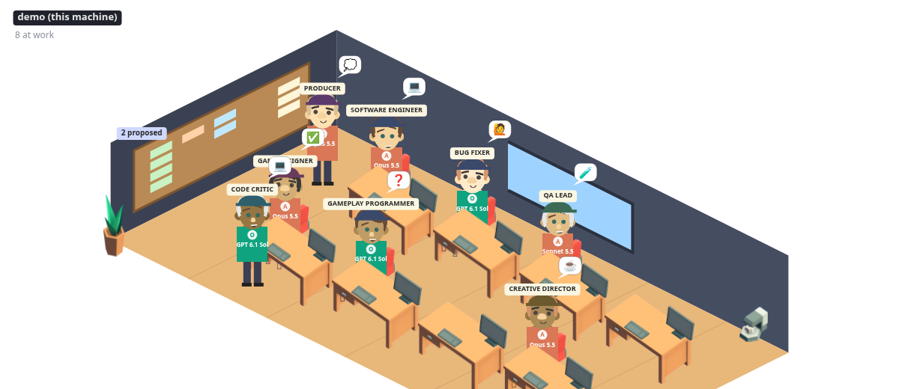
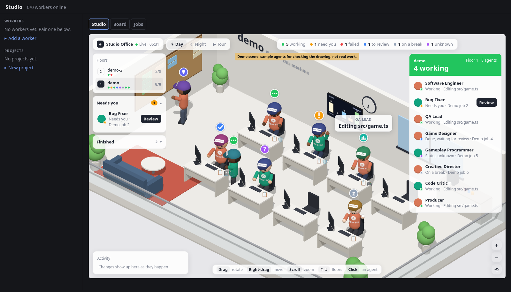
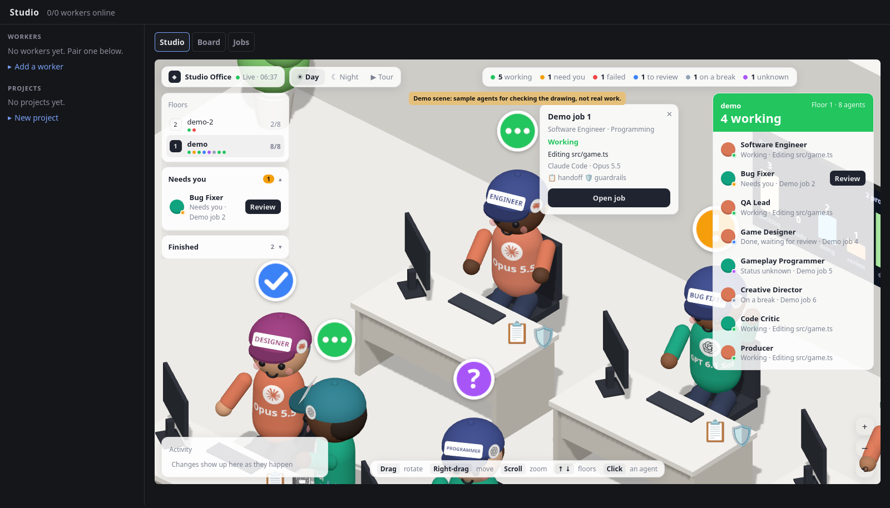

# Stage 2: minimal studio

Exit (PLAN.md §11): everyday work can be understood and managed from the studio view; progress
displays are tied to verified milestones. Validate whether the game view is useful during real work.

*The first 2D version, drawn from a sample scene (since removed).*

## Built

- `packages/sim`: pure scene builder (tested). Real hub state in; floors, desks, agents, wall out.
  Agents keep their desks; reviewers stand at the desk of the work they check; the Producer works at
  the wall board; finished agents leave after 30 minutes, except results waiting for your decision.
- States are distinct and never invented, shown as emoji speech bubbles: 💻 working (🧪 running
  tests, 💭 thinking, from the agent's latest activity), 🙋 needs you (pulsing), ❓ unknown, ☕ on a
  break, ✅ done and waiting for your review, ⏳ getting ready, ❌ failed, 🔌 machine unreachable (its
  floor also turns grey with a banner). No progress bars: only verified milestones.
- `apps/web/office.js`: canvas renderer. Hat = role (cap in the department colour), shirt = harness
  colour with vendor mark and model, desk widgets = equipped Kits, cork board = that machine's cards.
  Hover for details; click opens the job panel (approve, accept, integrate, rate). Redraws only on
  change, animates at 8 fps only while someone works or waits, and stops when hidden.
- Art: Kenney Furniture Kit and Character Pack (CC0), credited in `apps/web/assets`.
  Drop `apps/web/assets/logos/<vendor>.png` (e.g. `anthropic.png`) to replace the shirt initial.

## 3D office (2026-11-07)

Ideas taken from a "live bot office" dashboard (a video shared on X), rebuilt in Studio's own
look: their agents are coloured shapes; ours are little people.

- `apps/web/office3d.js` (three.js 0.187, vendored in `apps/web/vendor/three`, MIT): real 3D,
  orthographic camera, drag to rotate, right-drag to move, scroll to zoom, ↑/↓ for floors.
  One floor per machine; only the selected floor is drawn.
- Agents are built from simple shapes: a cap in the department colour with the role printed on the
  front panel and the harness's logo on a side patch (Claude Code, Codex), a t-shirt in the harness
  colour with the model family's logo (Claude, OpenAI, Gemini...; else the vendor's, else its
  initial) and the model name printed on the chest, skin/hair/trousers picked from `look`. Logos are
  `apps/web/assets/logos/<key>.svg`, from LobeHub Icons (names without `-color`). Poses: typing, hand up when it needs you, mug and closed eyes on a break, slumped and grey
  when failed or offline, arms back when done; reviewers stand at the desk with a hand on the chin.
- Status badges over heads (green dots working, teal bars running tests, indigo thinking, amber
  "!" needs you, blue check done, red cross failed, purple "?" unknown, grey z on a break).
- HUD: counters, floor directory with per-agent dots, Needs you and Finished lists (buttons open the
  job panel), the selected floor's people with what each is doing, an Activity log of changes this
  page has seen, hover label with the agent's latest activity line, click card with "Open job",
  Day/Night, and Tour (slow orbit, cycles floors).
- Sim: agents now carry `doing`, the latest activity title while working (shortened, never invented).
- The wall TV shows the floor's board counts; the wall clock shows real time.
- Not copied: their usage meter. Studio has no real usage numbers yet, and §10 says not to invent
  capacity; add it when the hub can read real usage.
- Falls back to the 2D view without WebGL, or with `?flat`.
- The demo scene (`?demo`) was removed on 2026-11-07: the office only ever shows the hub's real
  state. With no machines paired it says so instead of drawing an office.

## To validate in real use

- Is the office the view you keep open? What do you still go to the Jobs tab for?
- Readability at your screen size; more than 8 agents on one machine (extras wait off screen today).
